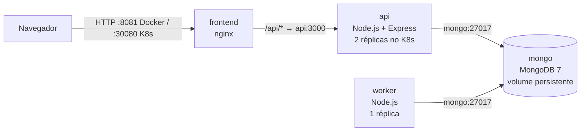

# Finanças da Família

Trabalho Prático de DevOps II (Tema 2).

## Tema

Muitas famílias perdem o controle do orçamento porque as despesas fixas e os gastos pequenos só são percebidos no fim do mês. O sistema permite:

- cadastrar categorias de receitas e despesas;
- registrar, editar e excluir receitas e despesas (descrição, valor, categoria e data);
- consultar o saldo do mês e o total de despesas por categoria;
- ver o relatório do mês (receitas, despesas e saldo);
- ver os alertas gerados pelo worker.

**Worker:** a cada minuto, soma as despesas do mês atual. Se o total passar do limite geral (R$ 3.000,00, configurável pela variável `LIMITE_DESPESAS`), registra um alerta na coleção `alertas`. É registrado no máximo um alerta por mês.

## Arquitetura



- O **frontend** é o único serviço acessível de fora. O nginx serve as telas e repassa as chamadas `/api/` para o serviço `api`.
- A **API** e o **MongoDB** só são acessíveis por dentro da rede Docker ou do cluster.
- O **worker** não recebe requisições. Ele só acessa o banco.
- Os serviços se encontram pelo nome (`api`, `mongo`), tanto no Docker Compose quanto nos Services do Kubernetes.

| Pasta | Conteúdo |
|---|---|
| `api/` | API REST (Node.js + Express + driver MongoDB) |
| `frontend/` | Telas em HTML/JS servidas por nginx |
| `worker/` | Rotina de alertas (`worker.js`) e dados de exemplo (`seed.js`) |
| `k8s/` | YAMLs do Kubernetes, configuração do cluster kind e script de testes |
| `docker-compose.yml` | Sistema completo com Docker Compose |

## Coleções do MongoDB (banco `financas`)

| Coleção | Campos |
|---|---|
| `membros` | `nome`, `parentesco` |
| `categorias` | `nome`, `tipo` (`receita` ou `despesa`) |
| `lancamentos` | `descricao`, `valor`, `categoria_id`, `categoria` (nome), `tipo`, `data` (`AAAA-MM-DD`) |
| `recorrencias` | `descricao`, `valor`, `categoria_id`, `dia_vencimento`, `membro_id` |
| `alertas` | `mes` (`AAAA-MM`), `total_despesas`, `limite`, `mensagem`, `criado_em` |

## Rotas da API

| Método | Rota | Descrição |
|---|---|---|
| GET / POST | `/api/categorias` | Lista / cadastra categoria |
| DELETE | `/api/categorias/:id` | Exclui categoria (sem lançamentos) |
| GET | `/api/lancamentos?mes=AAAA-MM` | Lista lançamentos |
| POST | `/api/lancamentos` | Registra lançamento |
| PUT / DELETE | `/api/lancamentos/:id` | Edita / exclui lançamento |
| GET | `/api/saldo?mes=AAAA-MM` | Saldo do mês |
| GET | `/api/despesas-por-categoria?mes=AAAA-MM` | Total de despesas por categoria |
| GET | `/api/relatorio?mes=AAAA-MM` | Receitas, despesas e saldo do mês |
| GET | `/api/alertas` | Alertas do worker |
| GET | `/api/health` | Status e versão da API |

## Rodando com Docker

Requisitos: apenas Docker e Docker Compose.

```bash
# 1. Subir o sistema (cria a rede, o volume e as imagens)
docker compose up -d --build

# 2. Carregar os dados de exemplo
docker compose exec worker node seed.js
```

Acesse **http://localhost:8081**. Em até 1 minuto o worker registra um alerta, porque as despesas de exemplo somam R$ 3.180,00.

O MongoDB não publica a porta 27017 no computador. A API e o worker se conectam a ele pelo nome do serviço `mongo`, dentro da rede `rede-financas`.

**Teste de persistência (D3).** Apaga e recria o container do banco. Os dados continuam lá porque ficam no volume `mongo-data`:

```bash
curl http://localhost:8081/api/relatorio
docker compose rm -sf mongo
docker compose up -d mongo
curl http://localhost:8081/api/relatorio
```

**Publicar as imagens v1 no Docker Hub (D4).** Antes, troque `seu-usuario` no arquivo `.env` pelo usuário do Docker Hub:

```bash
docker login
docker compose build
docker compose push api worker frontend
```

**Imagem v2 do frontend (usada no teste K8).** Só muda a versão exibida no rodapé:

```bash
docker build -t <usuario>/financas-frontend:v2 --build-arg VERSAO=v2 frontend
docker push <usuario>/financas-frontend:v2
```

Para parar: `docker compose down`. Para parar e apagar os dados também: `docker compose down -v`.

## Rodando no Kubernetes

Requisitos: Docker, [kind](https://kind.sigs.k8s.io/) e kubectl. As imagens precisam estar publicadas no Docker Hub (seção anterior).

```bash
# 1. Criar o cluster: 1 nó de controle e 2 nós de trabalho (K1)
kind create cluster --name financas --config k8s/cluster/kind-config.yaml
kubectl get nodes

# 2. Nos arquivos k8s/api.yaml, k8s/worker.yaml e k8s/frontend.yaml,
#    trocar "seu-usuario" pelo usuário do Docker Hub

# 3. Subir os 4 Deployments, 4 Services e o PVC (K2, K3, K4)
kubectl apply -f k8s/
kubectl get deployments,services,pvc,pods -o wide

# 4. Carregar os dados de exemplo
kubectl exec deploy/worker -- node seed.js
```

Acesse **http://localhost:30080**.

| Serviço | Réplicas | Service |
|---|---|---|
| frontend | 1 | NodePort 30080 (acessível pelo navegador) |
| api | 2 | ClusterIP (só dentro do cluster) |
| mongo | 1 | ClusterIP (só dentro do cluster) + PVC `mongo-pvc` |
| worker | 1 | Headless (não recebe requisições) |

### Por que o worker tem só 1 réplica?

Cada réplica do worker roda a verificação de forma independente a cada minuto. Com 2 réplicas, as duas fariam a mesma verificação ao mesmo tempo e o alerta sairia duplicado. A verificação também não precisa de mais capacidade: é uma consulta simples por minuto. Por isso o Deployment usa `replicas: 1` e a estratégia `Recreate`, que garante que nunca existam dois workers ao mesmo tempo, nem durante uma atualização.

## Testes no cluster (K5 a K8)

O script `k8s/testes.sh` roda todos os testes em sequência, com uma pausa entre eles:

```bash
bash k8s/testes.sh <usuario-dockerhub>
```

Os comandos usados em cada teste:

**K5: falha da API.** Um pod é apagado, o Deployment cria outro e a outra réplica continua respondendo.
```bash
kubectl get pods -l app=api
kubectl delete pod <nome-de-um-pod-da-api>
curl http://localhost:30080/api/health
kubectl get pods -l app=api
```

**K6: persistência do banco.** O pod é recriado e usa o mesmo PVC.
```bash
curl http://localhost:30080/api/relatorio
kubectl delete pod -l app=mongo
kubectl get pods -l app=mongo -w
curl http://localhost:30080/api/relatorio
```

**K7: escala.**
```bash
kubectl scale deployment api --replicas=3
kubectl get pods -l app=api
kubectl scale deployment api --replicas=2
kubectl get pods -l app=api
```

**K8: atualização de versão e retorno.** O frontend usa `RollingUpdate` com `maxUnavailable: 0`: o pod v2 sobe antes do v1 ser desligado. O `preStop` espera o Service parar de mandar tráfego para o pod antigo, então não há interrupção. O script faz requisições contínuas durante a troca para mostrar isso.
```bash
kubectl set image deployment/frontend frontend=<usuario>/financas-frontend:v2
kubectl rollout status deployment frontend
# rodapé mostra "Versão v2"
kubectl rollout undo deployment frontend
kubectl rollout status deployment frontend
# rodapé volta para "Versão v1"
```

Para apagar o cluster: `kind delete cluster --name financas`.
